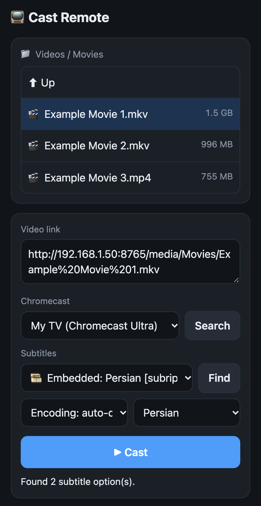
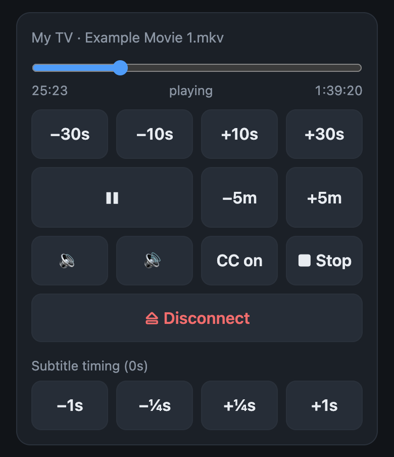

# castremote

Play videos on a Chromecast from your phone's browser, with subtitles.

castremote runs on a computer on your home network. Open its page on your phone, pick a video from a folder or paste a link, and it plays on the TV. The Chromecast fetches the video directly and the computer handles the subtitles, so the phone is only a remote and uses very little battery. There's nothing to install on the phone.

<p>
  
  &nbsp;
  
</p>

*The screenshots use demo data.*

## Features

- **Pick a video** from a configured folder, or paste any `http(s)` video link
- **Finds your Chromecasts** automatically
- **Audio track choice** for videos with more than one, such as a dubbed and an original track
- **Remote control:** play/pause, seek, skip, volume, stop and disconnect
- **Subtitles** from three sources:
  - files next to the video (`.srt`, `.vtt`, `.ass`, `.ssa`)
  - text tracks embedded in the video, extracted when you cast
  - a file uploaded from your phone
- **Subtitle controls:** adjust timing, turn them on or off, or switch tracks without losing your place
- **Persian and Arabic support:**
  - detects legacy encodings such as Windows-1256, with a manual override
  - keeps right-to-left punctuation at the correct end of the line
  - uses the Persian forms of ی and ک

## Requirements

- Python 3.8 or newer
- [FFmpeg](https://ffmpeg.org/) (`ffmpeg` and `ffprobe` on your `PATH`)
- A Chromecast on the same network as the computer

## Setup

```sh
git clone <this-repo-url> castremote
cd castremote
python3 -m venv .venv
.venv/bin/pip install -r requirements.txt
cp config.example.json config.json   # then set media_dir to your videos folder
.venv/bin/python app.py
```

The app prints an address such as `http://192.168.1.50:8765`. Open it on your phone. In Chrome, **Add to Home screen** makes it open like an app.

## Configuration

Settings are in `config.json`. Restart the app after changing them.

| Setting | Default | Purpose |
|---|---|---|
| `media_dir` | none | Folder to browse. Without it, the folder list is hidden and you paste links instead. |
| `port` | `8765` | Port the app listens on. |
| `cast_hosts` | `[]` | Chromecast IP addresses, if automatic discovery doesn't find yours. |
| `public_host` | `""` | Address the Chromecast should use to reach this computer, if the detected one is wrong. |
| `log_requests` | `false` | Log every request. Useful for troubleshooting, but noisy. |

The environment variables `PORT`, `CAST_HOSTS` (comma-separated) and `CASTREMOTE_CONFIG` (path to a config file) override these.

## Security

**castremote has no password and listens on all network interfaces.** Anyone who can reach its port can browse and download videos in `media_dir`, control your Chromecast, and make the computer fetch URLs through FFmpeg.

Only run it on a network you trust, and never forward its port to the internet.

## Troubleshooting

| Problem | What to try |
|---|---|
| No Chromecast found | Check that both are on the same network, or set `cast_hosts`. |
| The phone can't open the page | Allow the port through the computer's firewall. |
| The Chromecast can't play a link | Use the computer's network address, not `localhost`. |
| Video won't play or has no sound | The Chromecast may not support its format. The app warns you about this when it inspects the video. H.264 or HEVC video with AAC audio is the safest choice. |
| Seeking doesn't work on a pasted link | The server hosting the video must support HTTP range requests. `python -m http.server` doesn't. Videos picked from `media_dir` support seeking. |
| Seeking is slower with another audio track | Only the first audio track plays directly. Other tracks are streamed through FFmpeg, so each seek restarts the stream from the nearest keyframe. Tracks the Chromecast can't play, such as AC3 or DTS, are converted to stereo AAC. |
| Subtitles are garbled | Choose a different encoding next to the subtitle list, then cast again. |
| An embedded subtitle shows as unsupported | Image-based tracks (PGS, VobSub) can't be converted to text. |
| Embedded subtitles from a link are slow | FFmpeg has to read the whole file over the network. A separate subtitle file loads much faster. |

## License

[MIT](LICENSE)
